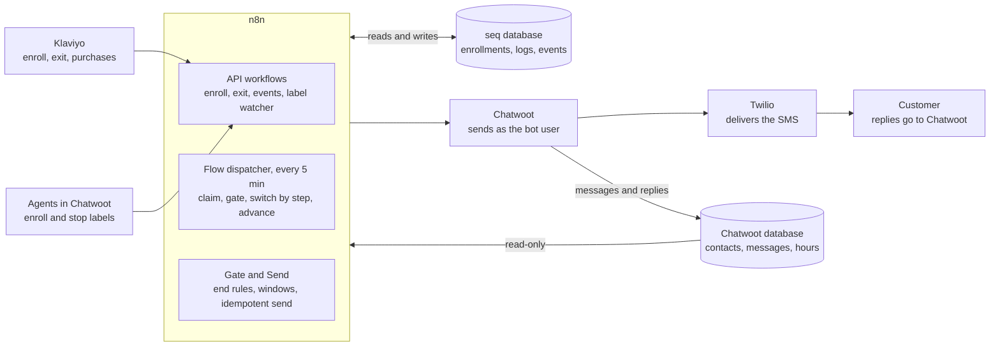

# SMS Sequence Engine on n8n + Chatwoot: design

Builder handoff from Nov 14, 2026, kept verbatim below. The section first lists where this deployment departs
from it; the departures win where the two differ.

## Adjustments for the PlayYourCourt deployment

- **Default timezone is Central** (`America/Chicago`), and the legal window is checked in the recipient's zone and
  Central. Decided Nov 14, 2026.
- **`exclude_from_drip` (Salesforce checkbox) is a global suppression** next to opt-out: Enroll answers
  `skipped_excluded`, the Gate exits `excluded_from_drip`. The `no_prior_conversation` end rule (`inbox_ids`; only
  conversations with a real message count, not ones holding private notes alone) and a `field` rule on `drip_step` keep
  people who already got the Salesforce drip out of its replacement.
- **Consent is `sms_opted_out_at`** (contact custom attribute, date or null), not an `sms_consent` boolean. Chatwoot
  sets it on STOP, clears it on START, syncs it to Klaviyo, and the Salesforce import backfills it. The Gate treats a
  non-null value as no consent; a STOP sets it and the engine then exits the enrollment.
- **Send goes through Chatwoot's Klaviyo outreach endpoint**
  (`POST /api/v1/accounts/:id/integrations/klaviyo/outreach`, `app/services/klaviyo/outreach_service.rb`): one call
  that upserts the contact, reuses or opens the conversation on the flow's inbox and sends the text. The **bot user
  is tech@**, whose token Klaviyo already uses, so the "agent messaged them" rule excludes its user id and treats
  Klaviyo-sent texts as automated too.
- **Labels cannot contain `:`** in Chatwoot, so the labels are `stop-sequence`, `enroll-<flow_key>` and
  `in-sequence-<flow_key>`. `salesforce:setup` creates them (`DataImports::Salesforce::Setup::SEQUENCE_FLOWS`).
- **Chatwoot OSS has no inbox date overrides.** Holidays are a date list in `seq_flows.send_window`.
- **Exits leave a private note.** When the Gate exits a row (replied, purchased, excluded, stop label, no window…),
  the flow posts a private note on the contact's latest conversation on the flow's inbox, e.g. `Left the "Lessons lead
  drip" SMS sequence at step 2: purchased (LESSON-PACK-4).` Exits from the Exit API or the label watcher don't,
  and a row that exits before its first text has no conversation to note on.
- **Flow settings live in the flow workflow.** Each `Flow: <key>` starts with a marketer-editable **Flow config** node
  (inbox, status, re-entry policy, end rules, business hours, holidays, flow window, spread, failure policy) and upserts
  it into `seq_flows` on every tick. The database row is derived from the published workflow; nobody inserts it by hand.
  The node also carries the message placeholders `rep_first_name`, `rep_phone` and `checkout_url` (stored in
  `seq_flows.vars`); the enroll webhook can override `checkout_url` per contact (`seq_enrollments.params`).
- **Two flows ship out of the box**: `lessons` (the six-step Salesforce drip: day 0, 24h, 48h, 7d, 14d, 6 weeks) and
  `membership` (one text with the checkout link for an abandoned membership signup).
- **Outreach conversations start as `pending`**, not snoozed: they stay out of the open queue, and a Chatwoot
  automation rule (message created, incoming, status pending → open conversation) hands them to agents on the
  contact's first reply. Snoozing is left to agents. No custom code: Chatwoot itself only reopens snoozed or
  resolved conversations on reply.
- **Timezone fallbacks**: `timezone` attribute → `postal_code` → area code → both coasts (`tz_data.json`; source
  recorded as `salesforce`/`contact`, `postal_code`, `phone`, `default`). Multi-zone prefixes must be legal in every zone.
- **Only the enrolled number is texted.** Gate exits: `phone_changed`, `contact_deleted`, `merged_duplicate`; a merged
  contact is followed by phone number. Flows are generated `paused`, and a paused flow claims nothing.
- **Delivery failures** (Chatwoot message status failed) are picked up by housekeeping: log row marked failed, a
  `failed` step log (counted in the alert email) and a private note on the conversation. The sequence continues.
- **Ticks are every minute**, claiming up to 200 due rows per flow per tick (`FOR UPDATE SKIP LOCKED` plus
  `claimed_at`, so an overlapping execution never double-claims; housekeeping releases claims older than 15 minutes).
- **Contact attributes** `timezone` (IANA), `timezone_source` (`salesforce`, `contact`, `phone`, `default`) and
  `sequence_status` are created by `salesforce:setup`; the Salesforce import converts its Rails-style zone names
  to IANA and sets `timezone_source = salesforce`.
- **n8n runs on Postgres locally as well as in production** (`deploy/n8n/setup_db.sh` creates `n8n` and `seq`
  databases and the `n8n`, `seq_engine` and `chatwoot_readonly` roles on either cluster).
- **Purchase events** (tabled Nov 14, 2026): source undecided, probably Klaviyo at first, which has two metrics, one
  per sale and one per item. Each posts to `/webhook/events` as its own `kind = 'purchase'` row; the per-item row
  carries the item (sku, name, amount) in `payload` so the "bought specific products" rule can match on it, and
  the sale row carries the order total. Chatwoot stores no purchases itself (its Shopify integration reads orders
  live); the Events workflow mirrors summary attributes (`last_purchase_at`, `last_purchase_item`) to the contact.
- **Alerts** go by email to keith@playyourcourt.com through Chatwoot's SMTP settings.
- **Not built in v1** (Nov 14, 2026): the Gate recheck and per-row lock inside Send (Send runs seconds after the
  Gate in the same execution), the per-inbox throttle, private notes on start/end, the DRAFT/live copies, the
  Mermaid diagram generator, the nightly `n8n export:workflow` and the Metabase/NocoDB reports. `push.py` is the
  deploy path instead of imports. Send applies the outcome to the enrollment itself; the flow has no separate
  Advance node (it would run the same update twice).
- The engine needs no Chatwoot code. The Chatwoot changes that exist (opt-out tracking, Klaviyo consent sync, the
  outreach endpoint) predate it and are used by it.

---

# SMS Sequence Engine on n8n + Chatwoot: Builder Handoff

Nov 14, 2026

## Summary

We are building multi-step SMS sequences that run for weeks or months, with n8n as the worker, Postgres as the state store, and Chatwoot as the sender and source of contact data. No n8n Wait nodes are used: each customer is a row with a `next_run_at`, and a scheduled workflow picks up due rows, sends one message, writes the next wake-up time, and exits.

**In scope**

- One n8n workflow per flow, readable top to bottom, where marketers can change copy, delays and simple conditions for steps people have not reached yet
- Enroll and exit by API (Klaviyo webhooks) and by Chatwoot label
- End rules checked before every step: replied, agent messaged, purchased, profile field, manual stop
- Send windows: legal quiet hours in the recipient's timezone, plus optional inbox business hours, with deferral and spreading
- A full record of what was sent to whom, and why a message was skipped

**Out of scope for v1**

- A drag-and-drop journey builder and on-canvas results
- A native Chatwoot sidebar panel (state is mirrored to labels and a custom attribute instead)
- Email steps

**Agreed behaviors**

- Editing a step applies to everyone who has not reached it. People already waiting keep the delay they were given.
- Conditions read Chatwoot data only, by direct read-only SQL against Chatwoot's database.
- Re-entry is a per-flow setting.
- Marketers validate flows on the canvas and on a generated diagram. Engineers own the skeleton and the shared sub-workflows.

## Architecture

n8n holds no long-lived state. Every customer in a flow is a row in the `seq` database, and each n8n run lasts seconds.



Klaviyo and agents put people into flows through the API workflows. The dispatcher wakes due rows, the Gate decides send, defer or exit using Chatwoot's data, and Send posts through Chatwoot to Twilio. Replies and agent messages land in Chatwoot's database, where the Gate sees them before the next step.

**One message, start to finish**

1. The Schedule Trigger fires and the Claim query marks due rows for this flow.
2. The Gate checks consent, the stop label, end rules and send windows for all claimed rows in one pass.
3. Rows marked `exit` or `defer` are written back and leave the run.
4. The Switch routes each remaining row to its step. The step's config supplies copy, delay and next step.
5. Send rechecks the Gate, writes the message log row, and posts to Chatwoot as the bot user.
6. Advance writes the next step and `next_run_at`, and releases the claim.

## Key setup decisions

These are the things that cause double sends, lost messages or compliance problems if they are wrong.

**n8n**

1. Run n8n on Postgres, not the default SQLite. Use a separate database from the `seq_` tables.
2. Never use a Wait node for sequence timing. All timing is `next_run_at` in Postgres.
3. Set `GENERIC_TIMEZONE` and the workflow timezone to UTC. All timezone math happens in code, per contact.
4. One Schedule Trigger per flow workflow, every minute. Set the workflow to not start a new run while one is active, and rely on the claim step as the real guard.
5. Create a global Error Workflow that releases claims and alerts someone.
6. Turn on "Continue on Fail" at the item level inside the Send sub-workflow, so one bad row does not fail the batch.
7. Set execution pruning deliberately. n8n history is for debugging; the `seq_` tables are the record.
8. Queue mode (Redis plus workers) is optional. Add it when volume needs it.
9. Export all workflows to git nightly with `n8n export:workflow --all`. The Community Edition keeps one day of workflow history.
10. Keep a DRAFT copy of each flow workflow. Edit and test there, then swap which one is active. Saving a live workflow deploys it.

**Postgres**

1. Two credentials in n8n: read-write on the `seq` database, and a SELECT-only role on Chatwoot's database.
2. The engine role may INSERT and UPDATE `seq_message_logs` but not DELETE. Same for `seq_step_logs`.
3. Back up both databases. They are the system of record.

**Chatwoot**

1. Create a dedicated bot agent user and API token for sequence sends. Its user ID is how the "agent sent a message" end rule tells automated sends from human ones.
2. Create contact custom attributes: `timezone` (IANA name, such as `America/Chicago`), `timezone_source`, `sms_consent`, `sequence_status`.
3. Create labels: `stop-sequence`, and `enroll:<flow_key>` per flow that agents may start by hand.
4. One Twilio SMS inbox per sending number. Each flow names the inbox it sends from.
5. Set each inbox's business hours and timezone in Chatwoot. The engine reads them from there.

No changes to Chatwoot's code are needed. Run the stock image and upgrade it normally. The only coupling is the read-only SQL in the Gate, so re-run the acceptance tests after each Chatwoot upgrade.

**Twilio**

1. Confirm the messages-per-second limit for each number and set the per-inbox throttle below it.
2. Decide how STOP replies reach the engine: Twilio blocks further sends itself, but the engine must also set `sms_consent = false` and exit enrollments. Use the inbound message text or Twilio error 21610 on a failed send.

## Database schema

Six tables in a `seq` database. All timestamps are `timestamptz` in UTC.

These are custom tables the builder creates with a SQL script. n8n's built-in data tables are not used for state: they lack the row locking and unique constraints this design depends on.

| Table | Purpose | Key columns |
| --- | --- | --- |
| `seq_flows` | One row per flow, with settings engineers edit | `key` (unique), `name`, `status`, `inbox_id`, `reentry_policy` (`never`, `after_completion`, `after_exit`, `always`), `reentry_cooldown_days`, `end_rules` jsonb, `send_window` jsonb, `spread_hours`, `on_send_failure` (`continue`, `exit`, `hold`) |
| `seq_enrollments` | One row per customer per run of a flow | `flow_key`, `contact_id`, `phone`, `status` (`active`, `completed`, `exited`, `held`), `current_step`, `next_run_at`, `claimed_at`, `enrolled_at`, `ended_at`, `exit_reason`, `source`, `params` jsonb, `defer_count`, `variant` |
| `seq_step_logs` | Every step run, including skips and deferrals | `enrollment_id`, `step`, `outcome` (`sent`, `deferred`, `exited`, `skipped`, `failed`), `reason`, `inputs` jsonb, `ran_at` |
| `seq_message_logs` | Every message sent, as sent | `enrollment_id`, `contact_id`, `inbox_id`, `step`, `variant`, `body`, `idempotency_key` (unique), `chatwoot_message_id`, `twilio_sid`, `status`, `timezone`, `timezone_source`, `local_time`, `consent_snapshot`, `sent_at` |
| `seq_events` | Things that end flows or feed reports | `contact_id`, `phone`, `kind` (`purchase`, `opt_out`, `custom`), `payload` jsonb, `occurred_at`, `source` |
| `seq_api_keys` | Keys for Klaviyo and other callers | `name`, `token_digest`, `scopes`, `last_used_at`, `revoked_at` |

**Indexes that matter**

- `seq_enrollments (status, next_run_at)` for the claim query
- Unique partial index on `seq_enrollments (flow_key, contact_id) WHERE status = 'active'` so a retried webhook cannot enroll twice
- Unique on `seq_message_logs (idempotency_key)`, where the key is `enrollment_id:step:variant`
- `seq_events (contact_id, kind, occurred_at)`

**Not stored here**

Step copy, delays and conditions live in the n8n workflow's step config nodes. Contact fields, labels, messages and inbox hours are read from Chatwoot's database.

## n8n workflows

Eight workflows. Engineers own all of them; marketers edit only the step config and IF nodes inside a flow workflow.

| Workflow | Trigger | What it does |
| --- | --- | --- |
| Flow: `<flow_key>` (one per flow) | Schedule, every 5 min | Claim due rows, call Gate, route by step, call Send, Advance |
| Sub: Gate | Called by flows and by Send | Batch-checks end rules and send windows; returns `send`, `defer` or `exit` per row |
| Sub: Send | Called by flows | Rechecks the gate, renders copy, throttles, posts to Chatwoot, writes the message log |
| API: Enroll | Webhook `POST /enroll` | Checks key, finds or creates the Chatwoot contact, applies re-entry policy, inserts the enrollment |
| API: Exit | Webhook `POST /exit` | Checks key, ends active enrollments for a contact, optionally one flow only |
| API: Events | Webhook `POST /events` | Checks key, stores purchases and other events |
| Label watcher | Chatwoot webhook `conversation_updated` | `enroll:<flow_key>` label enrolls; `stop-sequence` label exits immediately |
| Housekeeping | Schedule, every 15 min | Releases stale claims, mirrors status to Chatwoot, sweeps replies during long waits, alerts on problems |

**Inside a flow workflow**

1. **Schedule Trigger.**
2. **Claim** (Postgres). Marks due rows as claimed and returns them. See the SQL below.
3. **Gate** (Execute Workflow, all rows in one call). Rows marked `defer` or `exit` are written back and stop here.
4. **Switch** on `current_step`, one output per step.
5. Per step, left to right:
   - **Step config** (Set node, marketer-editable): `message`, `delay_to_next`, `delay_unit`, `next_step`. The last step sets `next_step` to `done`.
   - **IF** (optional, marketer-editable): form-based conditions on fields already on the row.
   - **Send** (Execute Workflow).
   - **Advance** (Postgres, identical on every branch).
6. Sticky notes between step groups state the delay and a one-line description.

Send always comes before Advance, and both run in the same execution. A step with an A and B version has two Send nodes feeding one Advance. A step with no message is Step config, then Advance.

**Inside Send**

1. Take a per-row lock and re-run the Gate for that row.
2. Render the message with the contact's fields.
3. Wait for the per-inbox rate limit.
4. Insert the message log row with the idempotency key. If the insert conflicts, skip the send and report it as already sent, so Advance still runs.
5. Find or create the contact's conversation on the flow's inbox, then post the message through Chatwoot's API as the bot user.
6. Update the log row with Chatwoot's message ID and status.

Inserting the log row before calling Chatwoot means a crash can leave a logged but unsent message, never a double send. Housekeeping flags log rows with no Chatwoot message ID after 10 minutes.

Send never retries. If the outcome of a send is not known, the row is held for a person to resolve. See "Send failures" under Rules.

## Custom code required

The custom code is about ten SQL statements and six small JavaScript functions in Code nodes. Everything else is standard n8n nodes.

**SQL on the `seq` database**

```sql
-- Claim due rows (one per flow workflow)
UPDATE seq_enrollments e SET claimed_at = now()
WHERE e.id IN (
  SELECT id FROM seq_enrollments
  WHERE flow_key = 'winback' AND status = 'active'
    AND next_run_at <= now() AND claimed_at IS NULL
  ORDER BY next_run_at LIMIT 200
  FOR UPDATE SKIP LOCKED)
RETURNING e.*;

-- Advance (same node on every branch)
UPDATE seq_enrollments
SET current_step = $2, next_run_at = now() + ($3 || ' ' || $4)::interval,
    claimed_at = NULL, defer_count = 0
WHERE id = $1 AND status = 'active';

-- Complete (last step)
UPDATE seq_enrollments SET status = 'completed', ended_at = now(), claimed_at = NULL
WHERE id = $1 AND status = 'active';

-- Defer (from Gate)
UPDATE seq_enrollments
SET next_run_at = $2, claimed_at = NULL, defer_count = defer_count + 1
WHERE id = $1;

-- Exit (Gate, Exit API, label watcher)
UPDATE seq_enrollments
SET status = 'exited', ended_at = now(), exit_reason = $2, claimed_at = NULL
WHERE id = $1 AND status = 'active';

-- Release stale claims (Housekeeping)
UPDATE seq_enrollments SET claimed_at = NULL
WHERE status = 'active' AND claimed_at < now() - interval '15 minutes';
```

Plus inserts for enrollments, step logs, message logs and events, and the re-entry check in Enroll.

**SQL on Chatwoot's database (read-only)**

Confirm table and column names against the installed Chatwoot version before relying on these.

```sql
-- Contact replied since enrolling
SELECT 1 FROM messages m JOIN conversations c ON c.id = m.conversation_id
WHERE c.contact_id = $1 AND m.message_type = 0 AND m.created_at > $2 LIMIT 1;

-- A human agent messaged them since enrolling (excludes notes and the bot)
SELECT 1 FROM messages m JOIN conversations c ON c.id = m.conversation_id
WHERE c.contact_id = $1 AND m.message_type = 1 AND m.private = false
  AND m.sender_type = 'User' AND m.sender_id <> $3 AND m.created_at > $2 LIMIT 1;
```

Also needed: contact fields and `custom_attributes`, labels on the contact and its conversations, and the inbox's timezone and working hours. Put all of these in the Gate sub-workflow only, so a Chatwoot upgrade means one place to fix.

**JavaScript in Code nodes**

| Function | Where | Spec |
| --- | --- | --- |
| `resolveTimezone` | Gate, Enroll | Contact `timezone` attribute, else state from Twilio data, else phone area code, else `America/Chicago`. Returns zone and source. Needs two static lookup tables. |
| `nextOpenTime` | Gate | Given now, the contact's zone, and the flow's window settings, return now if open, else the next open instant within 14 days, else null. Uses Luxon, which n8n provides. |
| `spreadMinutes` | Gate | Stable offset per contact inside the spread, clamped so it never passes the window's close. |
| `evaluateEndRules` | Gate | Takes the flow's `end_rules` and the facts gathered by SQL; returns the first matching rule and its reason. |
| `renderMessage` | Send | Replaces `{{field}}` placeholders from contact data. Fails the row if any placeholder is unresolved. |
| `flowDiagram` | Separate utility | Reads a flow workflow's JSON through n8n's API and emits a Mermaid flowchart from the step config nodes, with live counts per step. |

```js
// spreadMinutes: FNV-1a hash, no external modules
function spreadMinutes(contactId, spreadHours) {
  let h = 2166136261;
  for (const ch of String(contactId)) {
    h ^= ch.charCodeAt(0);
    h = Math.imul(h, 16777619);
  }
  return (h >>> 0) % (spreadHours * 60);
}
```

**Standard nodes that replace code**

- API key check: the Crypto node hashes the header token; a Postgres lookup compares it to `token_digest`.
- Rate limiting: the HTTP Request node's batching option, one item per interval. Two flows sharing a number can still exceed the limit together. If that happens, wrap the send in a Postgres advisory lock keyed on the inbox.

## Rules: end conditions and send windows

The Gate runs before every step and again inside Send. It checks in this order and stops at the first result.

1. **Suppression.** `sms_consent` is false or an `opt_out` event exists: exit.
2. **Manual stop.** The `stop-sequence` label is present: exit.
3. **End rules** enabled on the flow: exit with the rule as the reason.
4. **Legal window** closed: defer.
5. **Business hours** (if the flow uses them) closed: defer.
6. **Flow window or holiday** (if set) closed: defer.
7. Otherwise: send.

**End rules available per flow** (stored in `seq_flows.end_rules`)

| Rule | Source | Options |
| --- | --- | --- |
| Bought anything | `seq_events` | Since enrolled (default) or within N days |
| Bought specific products | `seq_events` | Product IDs; since enrolled |
| Contact messaged us | Chatwoot `messages` | SMS, email or any; specific inboxes |
| Agent messaged them | Chatwoot `messages` | SMS, email or any; excludes private notes and the bot user |
| Profile field is, is not, is set, is empty | Chatwoot contact | Any standard field or custom attribute |
| Has or lacks a label | Chatwoot labels | Any label |

**Send windows**

- **Legal window, always on.** Monday to Saturday 9am to 9pm and Sunday noon to 9pm, checked in the recipient's timezone and also in Central. Both must be open. Admins may tighten this globally. It cannot be turned off or widened per flow. Confirm the exact hours with counsel.
- **Business hours, per flow.** Off, or follow the flow's Chatwoot inbox (its working hours, timezone and date overrides).
- **Flow window, per flow.** An optional narrower range, such as 10am to 6pm local.

**Deferral**

- A deferred row gets `next_run_at` = the next instant all enabled windows are open, plus the contact's spread offset. Default spread is 3 hours.
- The Gate runs again in full when the row wakes. Changes to inbox hours are picked up then; nothing is recomputed in advance.
- After 14 consecutive deferrals, exit with reason `no_send_window`.
- Every deferral and exit writes a `seq_step_logs` row with the reason and the values checked.

**Send failures: never retry automatically**

A message is attempted once. Turn off "Retry on Fail" on the Chatwoot HTTP node and on the Send sub-workflow, and do not add retry loops.

| What happened | Message log status | Enrollment |
| --- | --- | --- |
| Blocked before any request (Gate, missing placeholder, no consent) | `skipped` | Per rule: exit or defer |
| Chatwoot or Twilio returned a clear failure | `failed`, with the error code | Follows the flow's `on_send_failure`: `continue` to the next step (default), `exit`, or `hold` |
| Twilio reports an opt-out block (error 21610) | `failed` | Exit, set `sms_consent` false |
| Unknown: timeout, crash, or no response after the log row was written | `unknown` | `held`. Alert a person. No further sends until resolved. |

- `held` is a fourth enrollment status. The dispatcher ignores held rows.
- A person resolves a held row by checking the conversation in Chatwoot, then choosing skip (advance) or resend. A resend is a new message log row with a new key and the user's name on it.
- A rerun of a step whose log row already exists never sends. It passes the row to Advance, or to `held` if the status is `unknown`.

**Re-entry** is checked in Enroll against the flow's `reentry_policy` and cooldown. The response states the outcome: `enrolled`, `skipped_active`, `skipped_reentry`, `skipped_no_consent`, `skipped_excluded`, `skipped_in_other_flow` (one active flow per contact, any flow),
`skipped_prior_flow` (`no_enrollment_in` rule).

**Delays** are fixed when written. Editing `delay_to_next` on a step affects only people who pass that step afterward.

## Canvas conventions

The canvas shows every step but not the transitions between them, so layout and naming carry the sequence.

- **Time runs down the page.** One row per step off the Switch, in order.
- **Sticky note between rows** with the delay and a one-line description, such as "3 days, then reminder".
- **Node names carry step and timing:** `Step 4A · VIP · day 12`.
- **Lanes for forks.** Rows on the same path share a horizontal band with a colored sticky header. Use suffixes (3A, 3B) and merge back within one or two steps where possible.
- **Marketer-editable nodes are a different color.** Only Step config (Set) and IF nodes. Everything else is engineer-owned.
- **No SQL or expressions in marketer nodes.** Copy and delays are plain fields. Conditions use the IF node's form.
- **Never connect one step's row to another.** A connection would run both steps in the same tick.
- **Do not use Tidy Up.** It rearranges nodes by data flow and destroys the lanes.
- **Edit the DRAFT workflow.** Test with pinned sample rows, then swap which workflow is active.

**What marketers can change**

| Change | How | Who it affects |
| --- | --- | --- |
| SMS copy | `message` field on the step config | Everyone who has not received that step |
| Delay | `delay_to_next` and `delay_unit` on the previous step | Everyone who has not passed the previous step |
| Simple condition | IF node on that row | Everyone who has not reached that step |
| New step, new lane, A/B split | Ask an engineer | — |

For review, marketing uses the generated Mermaid diagram, which shows forks, merges and counts per step.

## Monitoring and reporting

**Alerts** (Housekeeping workflow, to Slack or email)

- Any failed execution of a flow workflow or API workflow
- Rows claimed for more than 15 minutes
- Message log rows with no Chatwoot message ID after 10 minutes
- Due rows older than 30 minutes (the dispatcher is behind)
- Twilio failure or rate-limit errors above a threshold
- Any enrollment with `defer_count` above 5
- Any enrollment moved to `held`

**Reports** (Metabase or NocoDB on the `seq` database)

- People per step, per flow: `SELECT flow_key, current_step, status, COUNT(*) FROM seq_enrollments GROUP BY 1, 2, 3`
- Drop-off by exit reason
- Per step and variant: sent, delivered, replied within 24 hours, purchased within 7 days
- Deferred backlog by reason

**Visible in Chatwoot**

- Every sequence message appears in the conversation, sent by the bot user.
- Housekeeping mirrors state to the contact: an `in-sequence:<flow_key>` label while active, and `sequence_status` such as "winback, step 3 of 10, next send Nov 17".
- A private note is posted when an enrollment starts, ends or is stopped, with the reason.

## Build order and acceptance tests

**Build order**

1. Schema, credentials, bot user, attributes and labels.
2. Send sub-workflow with idempotency, against a test number.
3. One flow workflow with two steps: Claim, Switch, Step config, Send, Advance.
4. Gate: suppression, manual stop, legal window, deferral with spread.
5. Enroll and Exit APIs with keys; label watcher.
6. End rules, Events API, business hours from the inbox.
7. Housekeeping, alerts, status mirroring, reports.
8. Diagram generator, DRAFT and live copies, nightly git export.
9. Klaviyo webhook actions pointing at Enroll, Exit and Events.

**Acceptance tests**

- [ ] A two-step flow sends both messages with the configured gap, and the customer leaves n8n between steps.
- [ ] Posting the same enroll request twice creates one enrollment.
- [ ] Running the dispatcher twice at once sends each message once.
- [ ] Killing n8n mid-send and restarting does not double send and does not strand the row.
- [ ] Editing step 3's copy changes what a customer at step 2 receives; editing step 2's delay does not move a customer already waiting.
- [ ] A send due at 11pm recipient-local is deferred to the next morning with a spread offset, and logged.
- [ ] A Sunday 10am send is deferred to after noon.
- [ ] A customer reply, an agent SMS, a purchase event and the `stop-sequence` label each end the flow before the next message, with the reason logged.
- [ ] The bot's own messages do not trigger the "agent messaged them" rule.
- [ ] A STOP reply sets `sms_consent` false and exits every active enrollment for that contact.
- [ ] A contact with no timezone gets Central, and `timezone_source` records that it was a default.
- [ ] A burst of 1,000 enroll requests returns under one second each, and sends drain at the configured rate.
- [ ] Restarting and upgrading n8n with customers mid-flow changes nothing for them.
- [ ] A send that times out is not retried: the message is logged as `unknown`, the enrollment is `held`, and an alert fires.
- [ ] A send that Twilio rejects is logged as `failed` and the flow follows `on_send_failure` without resending.

## Open items to verify

- [ ] Chatwoot table and column names for messages, labels, working hours and date overrides in the installed version
- [ ] Whether Chatwoot's date overrides and holidays are available in the Community Edition
- [ ] Which Chatwoot webhook event carries label changes, and its payload
- [ ] Twilio messages-per-second limit for each number, and A2P registration status
- [ ] Texas registration and quiet-hours requirements, with counsel
- [ ] Where purchase events come from, and which product identifier to use
- [ ] Message log retention period
- [ ] Klaviyo webhook timeout and retry behavior
- [ ] n8n's license terms for our use, and which n8n version we pin
- [ ] Expected enrollments per hour at peak, to size the claim limit and schedule interval
- [ ] Whether Chatwoot itself retries a failed Twilio send in its background jobs, and how to turn that off if it does

**Known limits of this design**

- A saved mistake in a live workflow affects every customer in that flow until it is fixed.
- The canvas does not draw transitions between steps; multi-step forks and loops are readable only on the generated diagram.
- There is no draft and publish, validation, or per-user change history beyond what the DRAFT copy and git export provide.
- If these limits start to hurt, the same `seq_` schema carries over to a purpose-built engine inside Chatwoot.
